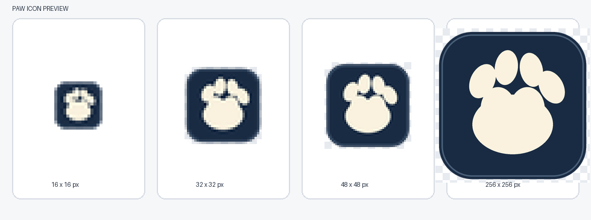

# PAW v2.5.0-rc3 前端修复与桌面图标

## `/app` 页面来源与改动范围

`/app` 由 `backend/main.py` 返回 `frontend/dist/index.html`，该文件加载预生成的 `frontend/dist/assets/index-qIwUsXqw.js?v=2.5.0`。它不是由 `backend/runtime/App.tsx` 构建。本次直接修补随安装包提供的 bundle，没有重建 `dist`，也没有改 `App.tsx`，所以没有引入未请求的界面差异。

## 问题、原因和修法

1. **审核后页面没有及时显示确认结果、驾驶舱卡片未同步刷新**：bundle 的审核详情只刷新本地详情和审核列表资源，没有广播已有的全局 `paw-refresh` 事件；成功提示也没有直说“已确认”。现在操作成功后广播该事件，让所有已挂载页面从同一 `/v1/web/brain/review/candidates` 接口重新取数。页面立即显示“已确认，后续处理已开始。”；失败显示“确认失败，请稍后重试。”。
2. **三条批量审核无法确认**：前端将所有勾选 ID POST 到 `/v1/web/brain/review/batch_accept`，并解析响应中的 `failed_count` 和逐条 `failed_details`；原界面只展示首条失败原因。仓库工作区没有运行中的 PAW 本地服务，也没有这三条对应的请求记录、候选 ID 或响应正文，因此无法据证据判断请求是否从用户客户端发出或逐条根因。后端代码显示 API 会逐条执行确认并返回失败详情。本次没有改后端。要定位这三条，需在出现它们的工作区复现并保存 API 响应。
3. **桌面和安装包图标**：新增 [assets/paw-app.ico](../assets/paw-app.ico)，包含 16、32、48、256 四种尺寸。`paw_desktop.spec` 将图标嵌入 EXE；`installer/paw_setup.iss` 设置安装程序图标，并明确桌面快捷方式使用应用 EXE 的图标。

## 验收文案兼容修正

提交 `db988b6` 曾把接受成功的精确提示改成新文字，导致现有 PM-U3-02 等待“已提交，等待 AI 巡航。”超时，首次 push `39595395224` 和 PR `39595408625` 的完整验证为 RED。修正提交 `7f7518b` 保留该精确提示，同时在详情页显示独立的“已确认，后续处理已开始。”状态，没有改验收脚本或判定。修正后 PM12 通过。

## 图标预览

图标预览同时已放入 PR #21。

## 最终提交检查

最终提交：`7f7518b950a09bb5f26bb34548a83d8f25e75674`

- push 完整验证：GREEN，运行 `39598259081`
- push 单测：GREEN，运行 `39598259182`
- PR #21 完整验证：GREEN，运行 `39598267771`
- PR #21 单测：GREEN，运行 `39598267867`
- PR 安装包构建：GREEN，运行 `39598267829`
- 本地 `node --check frontend/dist/assets/index-qIwUsXqw.js`：通过
- 本地 `python tests/paw_lint.py`：lint clean
- 本地 `python -m pytest tests/unit -q`：227 passed in 65.96s

## PR

https://github.com/riser-lang/paw-local-dev/pull/21（OPEN，未合并）
