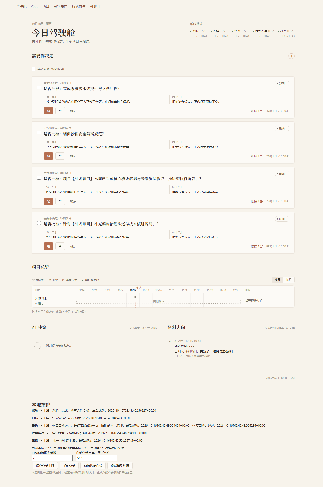
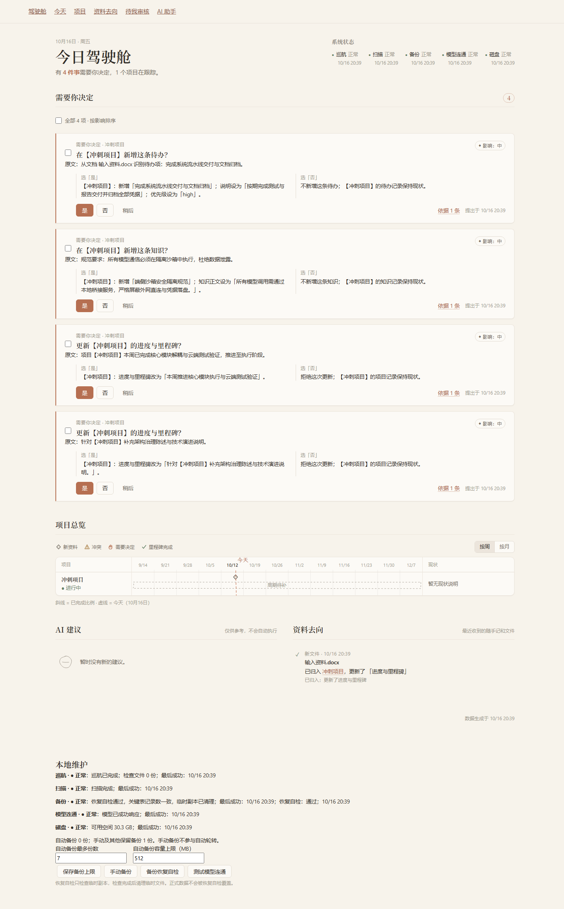
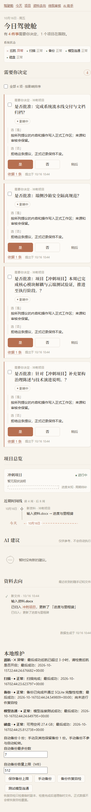
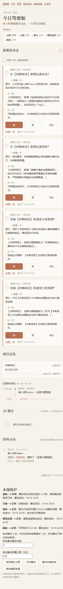

# DONE — v2.4.0-rc1 发布准备与四项界面P1

2026-10-16。依据REVIEW-C-05_07与产品负责人最新指令，在main准备RC；没有自行合并PR。

## 1. 子项对照

- 决定标题改为动作、项目及栏目，原文另起一行。候选使用真实稳定ID定位，重复动作标题不会选错卡片。
- 是/否后果按候选类型、操作、目标栏目和实际提议字段组装，不调用模型。旧项目候选别名、原文回退与批准共用纯转换，避免显示与提交字段不同。
- 本地维护成功时间、自检时间改为页面统一短格式；影响标签改为“影响：中”等。
- 当前程序版本、API、启动器、许可证版本、安装包和CI产物名统一2.4.0；repair_v238模块名保留。使用说明不修改。
- 仅制作草稿Release，附件来自tag的全量验证运行，不从独立打包运行混用。

## 2. 改动清单

- backend/pm/{decision_copy,project_payload,cockpit}.py：确定性决定说明，复用旧候选字段转换；repair_v238.py只提取同等转换，不改治理链。
- frontend/pm-src/{app.tsx,local.css,view_model.schema.json}与design组件：原文段落、可理解标签、短时间；本地schema只增可选excerpt。
- 版本入口：run.py、backend/main.py、产品指南GUIDE_VERSION、spec、iss、LICENSE、打包脚本、index查询参数、audit_check.py、fixture标题、build/test工作流。旧打包辅助脚本的桌面路径改为运行时USERPROFILE。
- backend/core/startup_trace.py、run.py/main.py与start_paw：opt-in启动阶段观测，不记录用户内容/Key/配置地址；原40秒标准不变，正常关闭。
- PM06补充P1检查、稳定ID批处理；PM07补充短时间检查。响应式截图等待真实React布局分支挂载，保留溢出断言并输出前后几何数据。未改审核人用例和判定脚本。

## 3. 测试与原始判定

冻结提交：8684a318a5718233e7d72a4fe793f3e90e2672e1；tag：v2.4.0-rc1。
草稿Release：[v2.4.0-rc1](https://github.com/riser-lang/paw-local-dev/releases/tag/untagged-49710298c4c6d2c5c957)；已核实isDraft=true、isPrerelease=true。
安装包：PAW_Personal_Work_OS_Setup_v2.4.0.exe，34803055字节，SHA256：`2a77e376fb8dbd5a195766d7cac4038045124085b5485256e647d8db91639084`。本地逐字节哈希与tag工件校验文件及GitHub上传资产digest一致。另附原始SHA256文件和未修改内容的PAW_User_Guide.txt。

| 阶段 | 提交 | 完整验收 | unit | 独立打包 |
|---|---|---|---|---|
| 首轮main | 28f98e2 | [38895175159](https://github.com/riser-lang/paw-local-dev/actions/runs/38895175159) RED 68/70 | [38895175134](https://github.com/riser-lang/paw-local-dev/actions/runs/38895175134)112 GREEN | [38895175136](https://github.com/riser-lang/paw-local-dev/actions/runs/38895175136)GREEN |
| 响应式同步 | 71e5c35 | [38896715795](https://github.com/riser-lang/paw-local-dev/actions/runs/38896715795)RED 69/70：PM-B4-01启动失败，未到功能断言 | [38896715713](https://github.com/riser-lang/paw-local-dev/actions/runs/38896715713)112 GREEN | [38896715963](https://github.com/riser-lang/paw-local-dev/actions/runs/38896715963)GREEN |
| 启动观测 | 8684a31 | [38898663502](https://github.com/riser-lang/paw-local-dev/actions/runs/38898663502)GREEN 70/70 | [38898663667](https://github.com/riser-lang/paw-local-dev/actions/runs/38898663667)112 GREEN | [38898663594](https://github.com/riser-lang/paw-local-dev/actions/runs/38898663594)GREEN |
| 同提交稳定性复跑 | 8684a31 | [38900068195](https://github.com/riser-lang/paw-local-dev/actions/runs/38900068195)GREEN 70/70 | 同一提交上述unit | 同一提交上述打包 |
| RC1 tag | 8684a31 | [38901523871](https://github.com/riser-lang/paw-local-dev/actions/runs/38901523871)GREEN 70/70 | [38901523434](https://github.com/riser-lang/paw-local-dev/actions/runs/38901523434)112 GREEN | [38901523498](https://github.com/riser-lang/paw-local-dev/actions/runs/38901523498)GREEN |

PM-C1-01…05在最终三个同提交运行均PASS，六个负对照在各自预定检查失败。发布附件只使用tag完整验收38901523871的built-installer-exe，未混用独立build产物。

第二轮手机几何日志：PM-A2-01与PM-A4-01在390宽时同步前后均scrollWidth=375、布局phone；没有复现首轮DOM状态，因此首轮精确原因仍未确认。新增显式挂载同步保留原溢出断言和诊断截图。第三轮PM04的8次Python启动阶段至lifespan_ready为1.3555–1.5408秒，这不是完整冷启动计时；原40秒就绪标准未变。此前的启动失败没有阶段日志；新增opt-in启动阶段记录、端口探测，不代表已修复未知根因。

Tag B7回答耗时（原15秒标准）：B7-01 0.1757秒；B7-02 0.1135秒；B7-03 0.1457秒。原日志见该次B7 job。
B7-03计数：`{'model_calls': 1, 'model_seconds': 0.0224, 'prompt_bytes': 4793, 'search_seconds': 0.0, 'context_seconds': 0.0037, 'evidence_count': 1, 'context_bytes': 4423, 'total_seconds': 0.1251}`。


本地：112项unit通过、lint clean、前端构建与版本入口一致性检查通过；隔离源程序Edge真实批处理、旧助手/项目导航及1440/390截图通过。源程序检查不当作安装包验收。

首轮main 28f98e2、运行38895175159为68/70 RED：PM-A2-01与PM-A4-01在切换390px后检测到整页溢出。功能检查通过但不把整例算PASS。Edge重复缩放、12倍CPU降速和全页截图后切换未复现；首轮未记录DOM，不能认定其精确原因。后续71e5c35增加实际布局挂载同步与几何诊断，不隐藏溢出、不轮询溢出条件、不放宽断言；原始结果与后续证据全部列明。

### 首轮main [38895175159](https://github.com/riser-lang/paw-local-dev/actions/runs/38895175159) summary.md全文（原样）

```text
# Pipeline verdict for 28f98e2acdf931e937bf4e59c464e48dda76418e

Required cases: 70 | PASS 68 | FAIL 2 | NOT RUN 0

| Block | Case | Status | Failed check | Model |
|---|---|---|---|---|
| B1 | B1-01 | PASS |  | mock-llm |
| B1 | B1-02 | PASS |  | mock-llm |
| B1 | B1-03 | PASS |  | mock-llm |
| B2 | B2-01 | PASS |  | mock-llm |
| B2 | B2-02 | PASS |  | mock-llm |
| B2 | B2-03 | PASS |  | mock-llm |
| B3 | B3-01 | PASS |  | mock-llm |
| B3 | B3-02 | PASS |  | mock-llm |
| B3 | B3-03 | PASS |  | mock-llm |
| B3 | B3-04 | PASS |  | mock-llm |
| B4 | B4-01 | PASS |  | mock-llm |
| B4 | B4-02 | PASS |  | mock-llm |
| B4 | B4-03 | PASS |  | mock-llm |
| B4 | B4-04 | PASS |  | mock-llm |
| B4 | B4-05 | PASS |  | mock-llm |
| B4 | B4-06 | PASS |  | mock-llm |
| B4 | B4-07 | PASS |  | mock-llm |
| B5 | B5-01 | PASS |  | mock-llm |
| B5 | B5-02 | PASS |  | mock-llm |
| B5 | B5-03 | PASS |  | mock-llm |
| B6 | B6-01 | PASS |  | mock-llm |
| B6 | B6-02 | PASS |  | mock-llm |
| B7 | B7-01 | PASS |  | mock-llm |
| B7 | B7-02 | PASS |  | mock-llm |
| B7 | B7-03 | PASS |  | mock-llm |
| B8 | B8-01 | PASS |  | mock-llm |
| B8 | B8-02 | PASS |  | mock-llm |
| B8 | B8-03 | PASS |  | mock-llm |
| NEGATIVE-CONTROL | NC-01 | FAIL | project_update_committed | mock-llm |
| NEGATIVE-CONTROL | NC-02 | FAIL | explainer_fields_filled | mock-llm |
| NEGATIVE-CONTROL | NC-03 | FAIL | environment_clean | mock-llm |
| NEGATIVE-CONTROL | NC-PM-GOV | FAIL | formal_fields_unchanged_after_cruise | mock-llm |
| NEGATIVE-CONTROL | NC-PM-C1 | FAIL | cockpit_rendered | mock-llm |
| NEGATIVE-CONTROL | NC-PM-B2 | FAIL | old_version_superseded | mock-llm |
| PM02 | PM-B1-01 | PASS |  | mock-llm |
| PM02 | PM-B1-02 | PASS |  | mock-llm |
| PM02 | PM-B1-03 | PASS |  | mock-llm |
| PM02 | PM-B1-04 | PASS |  | mock-llm |
| PM02 | PM-B1-05 | PASS |  | mock-llm |
| PM02 | PM-B5-01 | PASS |  | mock-llm |
| PM02 | PM-GOV-01 | PASS |  | mock-llm |
| PM02 | PM-GOV-02 | PASS |  | mock-llm |
| PM02 | PM-GOV-03 | PASS |  | mock-llm |
| PM03 | PM-B2-01 | PASS |  | mock-llm |
| PM03 | PM-B2-02 | PASS |  | mock-llm |
| PM03 | PM-B2-03 | PASS |  | mock-llm |
| PM03 | PM-B2-04 | PASS |  | mock-llm |
| PM03 | PM-B2-05 | PASS |  | mock-llm |
| PM04 | PM-B3-01 | PASS |  | mock-llm |
| PM04 | PM-B3-02 | PASS |  | mock-llm |
| PM04 | PM-B3-03 | PASS |  | mock-llm |
| PM04 | PM-B3-04 | PASS |  | mock-llm |
| PM04 | PM-B3-05 | PASS |  | mock-llm |
| PM04 | PM-B3-06 | PASS |  | mock-llm |
| PM04 | PM-B4-01 | PASS |  | mock-llm |
| PM04 | PM-B4-02 | PASS |  | mock-llm |
| PM05 | PM-D1-01 | PASS |  | mock-llm |
| PM05 | PM-D1-02 | PASS |  | mock-llm |
| PM05 | PM-D1-03 | PASS |  | mock-llm |
| PM05 | PM-D2-01 | PASS |  | mock-llm |
| PM05 | PM-D2-02 | PASS |  | mock-llm |
| PM06 | PM-C1-01 | PASS |  | mock-llm |
| PM06 | PM-C1-02 | PASS |  | mock-llm |
| PM06 | PM-C1-03 | PASS |  | mock-llm |
| PM06 | PM-C1-04 | PASS |  | mock-llm |
| PM06 | PM-C1-05 | PASS |  | mock-llm |
| PM06 | PM-C2-01 | PASS |  | mock-llm |
| PM06 | PM-C2-02 | PASS |  | mock-llm |
| PM06 | PM-C2-03 | PASS |  | mock-llm |
| PM06 | PM-C3-01 | PASS |  | mock-llm |
| PM06 | PM-C4-01 | PASS |  | mock-llm |
| PM06 | PM-C5-01 | PASS |  | mock-llm |
| PM07 | PM-A1-01 | PASS |  | mock-llm |
| PM07 | PM-A2-01 | FAIL | no_page_overflow_390 | mock-llm |
| PM07 | PM-A4-01 | FAIL | no_page_overflow_390 | mock-llm |
| PM07 | PM-UP-01 | PASS |  | mock-llm |

## Problems
- PM-A2-01: FAIL (no_page_overflow_390)
- PM-A4-01: FAIL (no_page_overflow_390)

VERDICT: RED```

### 响应式同步main [38896715795](https://github.com/riser-lang/paw-local-dev/actions/runs/38896715795) summary.md全文（原样）

```text
# Pipeline verdict for 71e5c356102b6ba881d39ed6afcda78d068fc737

Required cases: 70 | PASS 69 | FAIL 1 | NOT RUN 0

| Block | Case | Status | Failed check | Model |
|---|---|---|---|---|
| B1 | B1-01 | PASS |  | mock-llm |
| B1 | B1-02 | PASS |  | mock-llm |
| B1 | B1-03 | PASS |  | mock-llm |
| B2 | B2-01 | PASS |  | mock-llm |
| B2 | B2-02 | PASS |  | mock-llm |
| B2 | B2-03 | PASS |  | mock-llm |
| B3 | B3-01 | PASS |  | mock-llm |
| B3 | B3-02 | PASS |  | mock-llm |
| B3 | B3-03 | PASS |  | mock-llm |
| B3 | B3-04 | PASS |  | mock-llm |
| B4 | B4-01 | PASS |  | mock-llm |
| B4 | B4-02 | PASS |  | mock-llm |
| B4 | B4-03 | PASS |  | mock-llm |
| B4 | B4-04 | PASS |  | mock-llm |
| B4 | B4-05 | PASS |  | mock-llm |
| B4 | B4-06 | PASS |  | mock-llm |
| B4 | B4-07 | PASS |  | mock-llm |
| B5 | B5-01 | PASS |  | mock-llm |
| B5 | B5-02 | PASS |  | mock-llm |
| B5 | B5-03 | PASS |  | mock-llm |
| B6 | B6-01 | PASS |  | mock-llm |
| B6 | B6-02 | PASS |  | mock-llm |
| B7 | B7-01 | PASS |  | mock-llm |
| B7 | B7-02 | PASS |  | mock-llm |
| B7 | B7-03 | PASS |  | mock-llm |
| B8 | B8-01 | PASS |  | mock-llm |
| B8 | B8-02 | PASS |  | mock-llm |
| B8 | B8-03 | PASS |  | mock-llm |
| NEGATIVE-CONTROL | NC-01 | FAIL | project_update_committed | mock-llm |
| NEGATIVE-CONTROL | NC-02 | FAIL | explainer_fields_filled | mock-llm |
| NEGATIVE-CONTROL | NC-03 | FAIL | environment_clean | mock-llm |
| NEGATIVE-CONTROL | NC-PM-GOV | FAIL | formal_fields_unchanged_after_cruise | mock-llm |
| NEGATIVE-CONTROL | NC-PM-C1 | FAIL | cockpit_rendered | mock-llm |
| NEGATIVE-CONTROL | NC-PM-B2 | FAIL | old_version_superseded | mock-llm |
| PM02 | PM-B1-01 | PASS |  | mock-llm |
| PM02 | PM-B1-02 | PASS |  | mock-llm |
| PM02 | PM-B1-03 | PASS |  | mock-llm |
| PM02 | PM-B1-04 | PASS |  | mock-llm |
| PM02 | PM-B1-05 | PASS |  | mock-llm |
| PM02 | PM-B5-01 | PASS |  | mock-llm |
| PM02 | PM-GOV-01 | PASS |  | mock-llm |
| PM02 | PM-GOV-02 | PASS |  | mock-llm |
| PM02 | PM-GOV-03 | PASS |  | mock-llm |
| PM03 | PM-B2-01 | PASS |  | mock-llm |
| PM03 | PM-B2-02 | PASS |  | mock-llm |
| PM03 | PM-B2-03 | PASS |  | mock-llm |
| PM03 | PM-B2-04 | PASS |  | mock-llm |
| PM03 | PM-B2-05 | PASS |  | mock-llm |
| PM04 | PM-B3-01 | PASS |  | mock-llm |
| PM04 | PM-B3-02 | PASS |  | mock-llm |
| PM04 | PM-B3-03 | PASS |  | mock-llm |
| PM04 | PM-B3-04 | PASS |  | mock-llm |
| PM04 | PM-B3-05 | PASS |  | mock-llm |
| PM04 | PM-B3-06 | PASS |  | mock-llm |
| PM04 | PM-B4-01 | FAIL | exception | mock-llm |
| PM04 | PM-B4-02 | PASS |  | mock-llm |
| PM05 | PM-D1-01 | PASS |  | mock-llm |
| PM05 | PM-D1-02 | PASS |  | mock-llm |
| PM05 | PM-D1-03 | PASS |  | mock-llm |
| PM05 | PM-D2-01 | PASS |  | mock-llm |
| PM05 | PM-D2-02 | PASS |  | mock-llm |
| PM06 | PM-C1-01 | PASS |  | mock-llm |
| PM06 | PM-C1-02 | PASS |  | mock-llm |
| PM06 | PM-C1-03 | PASS |  | mock-llm |
| PM06 | PM-C1-04 | PASS |  | mock-llm |
| PM06 | PM-C1-05 | PASS |  | mock-llm |
| PM06 | PM-C2-01 | PASS |  | mock-llm |
| PM06 | PM-C2-02 | PASS |  | mock-llm |
| PM06 | PM-C2-03 | PASS |  | mock-llm |
| PM06 | PM-C3-01 | PASS |  | mock-llm |
| PM06 | PM-C4-01 | PASS |  | mock-llm |
| PM06 | PM-C5-01 | PASS |  | mock-llm |
| PM07 | PM-A1-01 | PASS |  | mock-llm |
| PM07 | PM-A2-01 | PASS |  | mock-llm |
| PM07 | PM-A4-01 | PASS |  | mock-llm |
| PM07 | PM-UP-01 | PASS |  | mock-llm |

## Problems
- PM-B4-01: FAIL (exception)

VERDICT: RED```

### 启动观测main [38898663502](https://github.com/riser-lang/paw-local-dev/actions/runs/38898663502) summary.md全文（原样）

```text
# Pipeline verdict for 8684a318a5718233e7d72a4fe793f3e90e2672e1

Required cases: 70 | PASS 70 | FAIL 0 | NOT RUN 0

| Block | Case | Status | Failed check | Model |
|---|---|---|---|---|
| B1 | B1-01 | PASS |  | mock-llm |
| B1 | B1-02 | PASS |  | mock-llm |
| B1 | B1-03 | PASS |  | mock-llm |
| B2 | B2-01 | PASS |  | mock-llm |
| B2 | B2-02 | PASS |  | mock-llm |
| B2 | B2-03 | PASS |  | mock-llm |
| B3 | B3-01 | PASS |  | mock-llm |
| B3 | B3-02 | PASS |  | mock-llm |
| B3 | B3-03 | PASS |  | mock-llm |
| B3 | B3-04 | PASS |  | mock-llm |
| B4 | B4-01 | PASS |  | mock-llm |
| B4 | B4-02 | PASS |  | mock-llm |
| B4 | B4-03 | PASS |  | mock-llm |
| B4 | B4-04 | PASS |  | mock-llm |
| B4 | B4-05 | PASS |  | mock-llm |
| B4 | B4-06 | PASS |  | mock-llm |
| B4 | B4-07 | PASS |  | mock-llm |
| B5 | B5-01 | PASS |  | mock-llm |
| B5 | B5-02 | PASS |  | mock-llm |
| B5 | B5-03 | PASS |  | mock-llm |
| B6 | B6-01 | PASS |  | mock-llm |
| B6 | B6-02 | PASS |  | mock-llm |
| B7 | B7-01 | PASS |  | mock-llm |
| B7 | B7-02 | PASS |  | mock-llm |
| B7 | B7-03 | PASS |  | mock-llm |
| B8 | B8-01 | PASS |  | mock-llm |
| B8 | B8-02 | PASS |  | mock-llm |
| B8 | B8-03 | PASS |  | mock-llm |
| NEGATIVE-CONTROL | NC-01 | FAIL | project_update_committed | mock-llm |
| NEGATIVE-CONTROL | NC-02 | FAIL | explainer_fields_filled | mock-llm |
| NEGATIVE-CONTROL | NC-03 | FAIL | environment_clean | mock-llm |
| NEGATIVE-CONTROL | NC-PM-GOV | FAIL | formal_fields_unchanged_after_cruise | mock-llm |
| NEGATIVE-CONTROL | NC-PM-C1 | FAIL | cockpit_rendered | mock-llm |
| NEGATIVE-CONTROL | NC-PM-B2 | FAIL | old_version_superseded | mock-llm |
| PM02 | PM-B1-01 | PASS |  | mock-llm |
| PM02 | PM-B1-02 | PASS |  | mock-llm |
| PM02 | PM-B1-03 | PASS |  | mock-llm |
| PM02 | PM-B1-04 | PASS |  | mock-llm |
| PM02 | PM-B1-05 | PASS |  | mock-llm |
| PM02 | PM-B5-01 | PASS |  | mock-llm |
| PM02 | PM-GOV-01 | PASS |  | mock-llm |
| PM02 | PM-GOV-02 | PASS |  | mock-llm |
| PM02 | PM-GOV-03 | PASS |  | mock-llm |
| PM03 | PM-B2-01 | PASS |  | mock-llm |
| PM03 | PM-B2-02 | PASS |  | mock-llm |
| PM03 | PM-B2-03 | PASS |  | mock-llm |
| PM03 | PM-B2-04 | PASS |  | mock-llm |
| PM03 | PM-B2-05 | PASS |  | mock-llm |
| PM04 | PM-B3-01 | PASS |  | mock-llm |
| PM04 | PM-B3-02 | PASS |  | mock-llm |
| PM04 | PM-B3-03 | PASS |  | mock-llm |
| PM04 | PM-B3-04 | PASS |  | mock-llm |
| PM04 | PM-B3-05 | PASS |  | mock-llm |
| PM04 | PM-B3-06 | PASS |  | mock-llm |
| PM04 | PM-B4-01 | PASS |  | mock-llm |
| PM04 | PM-B4-02 | PASS |  | mock-llm |
| PM05 | PM-D1-01 | PASS |  | mock-llm |
| PM05 | PM-D1-02 | PASS |  | mock-llm |
| PM05 | PM-D1-03 | PASS |  | mock-llm |
| PM05 | PM-D2-01 | PASS |  | mock-llm |
| PM05 | PM-D2-02 | PASS |  | mock-llm |
| PM06 | PM-C1-01 | PASS |  | mock-llm |
| PM06 | PM-C1-02 | PASS |  | mock-llm |
| PM06 | PM-C1-03 | PASS |  | mock-llm |
| PM06 | PM-C1-04 | PASS |  | mock-llm |
| PM06 | PM-C1-05 | PASS |  | mock-llm |
| PM06 | PM-C2-01 | PASS |  | mock-llm |
| PM06 | PM-C2-02 | PASS |  | mock-llm |
| PM06 | PM-C2-03 | PASS |  | mock-llm |
| PM06 | PM-C3-01 | PASS |  | mock-llm |
| PM06 | PM-C4-01 | PASS |  | mock-llm |
| PM06 | PM-C5-01 | PASS |  | mock-llm |
| PM07 | PM-A1-01 | PASS |  | mock-llm |
| PM07 | PM-A2-01 | PASS |  | mock-llm |
| PM07 | PM-A4-01 | PASS |  | mock-llm |
| PM07 | PM-UP-01 | PASS |  | mock-llm |

## No problems

VERDICT: GREEN```

### 同提交稳定性 [38900068195](https://github.com/riser-lang/paw-local-dev/actions/runs/38900068195) summary.md全文（原样）

```text
# Pipeline verdict for 8684a318a5718233e7d72a4fe793f3e90e2672e1

Required cases: 70 | PASS 70 | FAIL 0 | NOT RUN 0

| Block | Case | Status | Failed check | Model |
|---|---|---|---|---|
| B1 | B1-01 | PASS |  | mock-llm |
| B1 | B1-02 | PASS |  | mock-llm |
| B1 | B1-03 | PASS |  | mock-llm |
| B2 | B2-01 | PASS |  | mock-llm |
| B2 | B2-02 | PASS |  | mock-llm |
| B2 | B2-03 | PASS |  | mock-llm |
| B3 | B3-01 | PASS |  | mock-llm |
| B3 | B3-02 | PASS |  | mock-llm |
| B3 | B3-03 | PASS |  | mock-llm |
| B3 | B3-04 | PASS |  | mock-llm |
| B4 | B4-01 | PASS |  | mock-llm |
| B4 | B4-02 | PASS |  | mock-llm |
| B4 | B4-03 | PASS |  | mock-llm |
| B4 | B4-04 | PASS |  | mock-llm |
| B4 | B4-05 | PASS |  | mock-llm |
| B4 | B4-06 | PASS |  | mock-llm |
| B4 | B4-07 | PASS |  | mock-llm |
| B5 | B5-01 | PASS |  | mock-llm |
| B5 | B5-02 | PASS |  | mock-llm |
| B5 | B5-03 | PASS |  | mock-llm |
| B6 | B6-01 | PASS |  | mock-llm |
| B6 | B6-02 | PASS |  | mock-llm |
| B7 | B7-01 | PASS |  | mock-llm |
| B7 | B7-02 | PASS |  | mock-llm |
| B7 | B7-03 | PASS |  | mock-llm |
| B8 | B8-01 | PASS |  | mock-llm |
| B8 | B8-02 | PASS |  | mock-llm |
| B8 | B8-03 | PASS |  | mock-llm |
| NEGATIVE-CONTROL | NC-01 | FAIL | project_update_committed | mock-llm |
| NEGATIVE-CONTROL | NC-02 | FAIL | explainer_fields_filled | mock-llm |
| NEGATIVE-CONTROL | NC-03 | FAIL | environment_clean | mock-llm |
| NEGATIVE-CONTROL | NC-PM-GOV | FAIL | formal_fields_unchanged_after_cruise | mock-llm |
| NEGATIVE-CONTROL | NC-PM-C1 | FAIL | cockpit_rendered | mock-llm |
| NEGATIVE-CONTROL | NC-PM-B2 | FAIL | old_version_superseded | mock-llm |
| PM02 | PM-B1-01 | PASS |  | mock-llm |
| PM02 | PM-B1-02 | PASS |  | mock-llm |
| PM02 | PM-B1-03 | PASS |  | mock-llm |
| PM02 | PM-B1-04 | PASS |  | mock-llm |
| PM02 | PM-B1-05 | PASS |  | mock-llm |
| PM02 | PM-B5-01 | PASS |  | mock-llm |
| PM02 | PM-GOV-01 | PASS |  | mock-llm |
| PM02 | PM-GOV-02 | PASS |  | mock-llm |
| PM02 | PM-GOV-03 | PASS |  | mock-llm |
| PM03 | PM-B2-01 | PASS |  | mock-llm |
| PM03 | PM-B2-02 | PASS |  | mock-llm |
| PM03 | PM-B2-03 | PASS |  | mock-llm |
| PM03 | PM-B2-04 | PASS |  | mock-llm |
| PM03 | PM-B2-05 | PASS |  | mock-llm |
| PM04 | PM-B3-01 | PASS |  | mock-llm |
| PM04 | PM-B3-02 | PASS |  | mock-llm |
| PM04 | PM-B3-03 | PASS |  | mock-llm |
| PM04 | PM-B3-04 | PASS |  | mock-llm |
| PM04 | PM-B3-05 | PASS |  | mock-llm |
| PM04 | PM-B3-06 | PASS |  | mock-llm |
| PM04 | PM-B4-01 | PASS |  | mock-llm |
| PM04 | PM-B4-02 | PASS |  | mock-llm |
| PM05 | PM-D1-01 | PASS |  | mock-llm |
| PM05 | PM-D1-02 | PASS |  | mock-llm |
| PM05 | PM-D1-03 | PASS |  | mock-llm |
| PM05 | PM-D2-01 | PASS |  | mock-llm |
| PM05 | PM-D2-02 | PASS |  | mock-llm |
| PM06 | PM-C1-01 | PASS |  | mock-llm |
| PM06 | PM-C1-02 | PASS |  | mock-llm |
| PM06 | PM-C1-03 | PASS |  | mock-llm |
| PM06 | PM-C1-04 | PASS |  | mock-llm |
| PM06 | PM-C1-05 | PASS |  | mock-llm |
| PM06 | PM-C2-01 | PASS |  | mock-llm |
| PM06 | PM-C2-02 | PASS |  | mock-llm |
| PM06 | PM-C2-03 | PASS |  | mock-llm |
| PM06 | PM-C3-01 | PASS |  | mock-llm |
| PM06 | PM-C4-01 | PASS |  | mock-llm |
| PM06 | PM-C5-01 | PASS |  | mock-llm |
| PM07 | PM-A1-01 | PASS |  | mock-llm |
| PM07 | PM-A2-01 | PASS |  | mock-llm |
| PM07 | PM-A4-01 | PASS |  | mock-llm |
| PM07 | PM-UP-01 | PASS |  | mock-llm |

## No problems

VERDICT: GREEN```

### RC1 tag [38901523871](https://github.com/riser-lang/paw-local-dev/actions/runs/38901523871) summary.md全文（原样）

```text
# Pipeline verdict for 8684a318a5718233e7d72a4fe793f3e90e2672e1

Required cases: 70 | PASS 70 | FAIL 0 | NOT RUN 0

| Block | Case | Status | Failed check | Model |
|---|---|---|---|---|
| B1 | B1-01 | PASS |  | mock-llm |
| B1 | B1-02 | PASS |  | mock-llm |
| B1 | B1-03 | PASS |  | mock-llm |
| B2 | B2-01 | PASS |  | mock-llm |
| B2 | B2-02 | PASS |  | mock-llm |
| B2 | B2-03 | PASS |  | mock-llm |
| B3 | B3-01 | PASS |  | mock-llm |
| B3 | B3-02 | PASS |  | mock-llm |
| B3 | B3-03 | PASS |  | mock-llm |
| B3 | B3-04 | PASS |  | mock-llm |
| B4 | B4-01 | PASS |  | mock-llm |
| B4 | B4-02 | PASS |  | mock-llm |
| B4 | B4-03 | PASS |  | mock-llm |
| B4 | B4-04 | PASS |  | mock-llm |
| B4 | B4-05 | PASS |  | mock-llm |
| B4 | B4-06 | PASS |  | mock-llm |
| B4 | B4-07 | PASS |  | mock-llm |
| B5 | B5-01 | PASS |  | mock-llm |
| B5 | B5-02 | PASS |  | mock-llm |
| B5 | B5-03 | PASS |  | mock-llm |
| B6 | B6-01 | PASS |  | mock-llm |
| B6 | B6-02 | PASS |  | mock-llm |
| B7 | B7-01 | PASS |  | mock-llm |
| B7 | B7-02 | PASS |  | mock-llm |
| B7 | B7-03 | PASS |  | mock-llm |
| B8 | B8-01 | PASS |  | mock-llm |
| B8 | B8-02 | PASS |  | mock-llm |
| B8 | B8-03 | PASS |  | mock-llm |
| NEGATIVE-CONTROL | NC-01 | FAIL | project_update_committed | mock-llm |
| NEGATIVE-CONTROL | NC-02 | FAIL | explainer_fields_filled | mock-llm |
| NEGATIVE-CONTROL | NC-03 | FAIL | environment_clean | mock-llm |
| NEGATIVE-CONTROL | NC-PM-GOV | FAIL | formal_fields_unchanged_after_cruise | mock-llm |
| NEGATIVE-CONTROL | NC-PM-C1 | FAIL | cockpit_rendered | mock-llm |
| NEGATIVE-CONTROL | NC-PM-B2 | FAIL | old_version_superseded | mock-llm |
| PM02 | PM-B1-01 | PASS |  | mock-llm |
| PM02 | PM-B1-02 | PASS |  | mock-llm |
| PM02 | PM-B1-03 | PASS |  | mock-llm |
| PM02 | PM-B1-04 | PASS |  | mock-llm |
| PM02 | PM-B1-05 | PASS |  | mock-llm |
| PM02 | PM-B5-01 | PASS |  | mock-llm |
| PM02 | PM-GOV-01 | PASS |  | mock-llm |
| PM02 | PM-GOV-02 | PASS |  | mock-llm |
| PM02 | PM-GOV-03 | PASS |  | mock-llm |
| PM03 | PM-B2-01 | PASS |  | mock-llm |
| PM03 | PM-B2-02 | PASS |  | mock-llm |
| PM03 | PM-B2-03 | PASS |  | mock-llm |
| PM03 | PM-B2-04 | PASS |  | mock-llm |
| PM03 | PM-B2-05 | PASS |  | mock-llm |
| PM04 | PM-B3-01 | PASS |  | mock-llm |
| PM04 | PM-B3-02 | PASS |  | mock-llm |
| PM04 | PM-B3-03 | PASS |  | mock-llm |
| PM04 | PM-B3-04 | PASS |  | mock-llm |
| PM04 | PM-B3-05 | PASS |  | mock-llm |
| PM04 | PM-B3-06 | PASS |  | mock-llm |
| PM04 | PM-B4-01 | PASS |  | mock-llm |
| PM04 | PM-B4-02 | PASS |  | mock-llm |
| PM05 | PM-D1-01 | PASS |  | mock-llm |
| PM05 | PM-D1-02 | PASS |  | mock-llm |
| PM05 | PM-D1-03 | PASS |  | mock-llm |
| PM05 | PM-D2-01 | PASS |  | mock-llm |
| PM05 | PM-D2-02 | PASS |  | mock-llm |
| PM06 | PM-C1-01 | PASS |  | mock-llm |
| PM06 | PM-C1-02 | PASS |  | mock-llm |
| PM06 | PM-C1-03 | PASS |  | mock-llm |
| PM06 | PM-C1-04 | PASS |  | mock-llm |
| PM06 | PM-C1-05 | PASS |  | mock-llm |
| PM06 | PM-C2-01 | PASS |  | mock-llm |
| PM06 | PM-C2-02 | PASS |  | mock-llm |
| PM06 | PM-C2-03 | PASS |  | mock-llm |
| PM06 | PM-C3-01 | PASS |  | mock-llm |
| PM06 | PM-C4-01 | PASS |  | mock-llm |
| PM06 | PM-C5-01 | PASS |  | mock-llm |
| PM07 | PM-A1-01 | PASS |  | mock-llm |
| PM07 | PM-A2-01 | PASS |  | mock-llm |
| PM07 | PM-A4-01 | PASS |  | mock-llm |
| PM07 | PM-UP-01 | PASS |  | mock-llm |

## No problems

VERDICT: GREEN```


## 4. 修改前后截图

修改前来自[38839156848](https://github.com/riser-lang/paw-local-dev/actions/runs/38839156848)的screens-PM07（C-07审核通过时UI）；修改后来自[38901523871](https://github.com/riser-lang/paw-local-dev/actions/runs/38901523871)的screens-PM07。桌面对应screen_PM_A2_01_1440.png，手机对应screen_PM_A4_01_390.png。

| 尺寸 | 修改前 | 修改后 |
|---|---|---|
| 1440 |  |  |
| 390 |  |  |

[原始图并排对照HTML](visuals/v2.4.0-rc1/comparison.html)。已人工查看桌面与手机原图。

原始PNG仅复制，未修改像素。来源均为有界面安装验收，真实页面/app/pm/today，内容均为虚构项目。源程序辅助图单独标识。

## 5. 风险与未确认

- 不发布正式版；仍需审核人与产品负责人验收，C-08至C-10尚不在本RC范围。
- 使用说明按本次裁定暂沿用原文，v2.5.0阶段再更新。
- 剩余2.3.9字样为冻结说明、历史交接、审核人不可改的旧版验收文字、负对照/覆盖升级基线及一次性verify_consistency.py还原证明；不属于当前产品版本入口。2.3.8修补模块名保持原样。
- PM-B3-01历史夹具身份波动、PM-B3-05历史启动失败、B7-03历史15秒回答超时均保留为不稳定记录；后续通过不等于已证明根因或根治。

## 6. 大白话摘要

决定卡片现在说清要改哪里，原文另行展示。
维护时间使用简短的本地格式。
安装包版本为2.4.0，经过tag全量验收。
仅创建草稿，等待审核与人工验收。
随后继续C-08至C-10。
